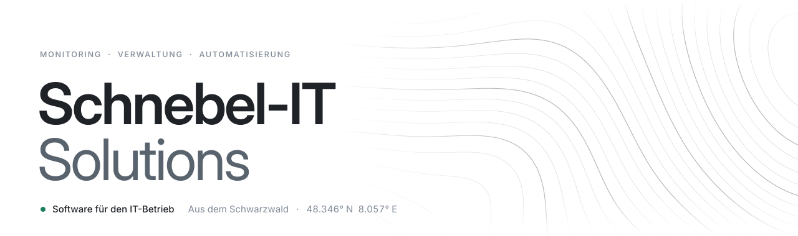
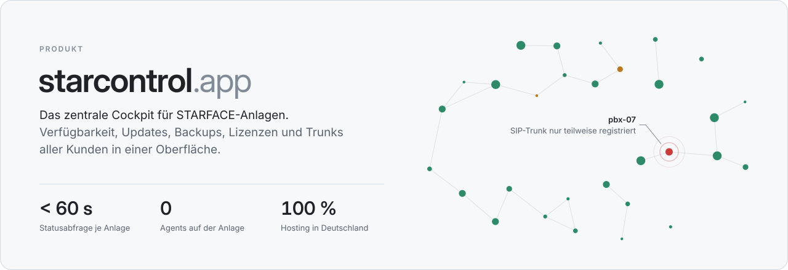

<picture>
  <source media="(prefers-color-scheme: dark)" srcset="profile/assets/header-dark.svg">
  
</picture>

 

Wir bauen Werkzeuge für Menschen, die IT betreiben. Was sich im eigenen Alltag bewährt, wird zum Produkt.

 

<a href="https://starcontrol.app">
  <picture>
    <source media="(prefers-color-scheme: dark)" srcset="profile/assets/starcontrol-dark.svg">
    
  </picture>
</a>

  <a href="https://starcontrol.app"><b>Live-Demo</b></a>
  &nbsp;&nbsp;·&nbsp;&nbsp;
  <a href="https://starcontrol.app/docs">Dokumentation</a>
  &nbsp;&nbsp;·&nbsp;&nbsp;
  <a href="https://starcontrol.app/auth/register">30 Tage testen</a>

 

**Intern** &nbsp; Der Rest dieser Organisation ist Software für den eigenen Betrieb: Integrationen, Automatisierungen und Werkzeuge, die den Alltag am Laufen halten. Die meisten Repositories sind deshalb privat.

 

<a href="https://schnebel-it.de">schnebel-it.de</a> &nbsp;·&nbsp; <a href="mailto:mail@starcontrol.app">mail@starcontrol.app</a>
